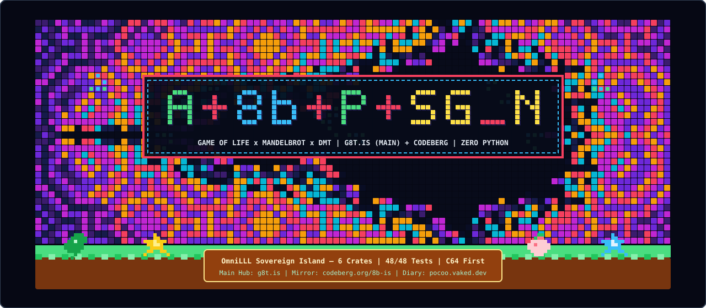
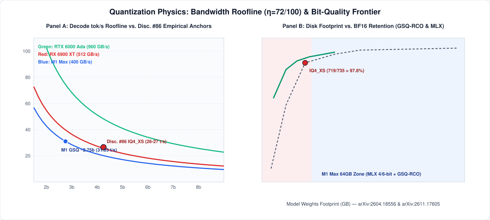
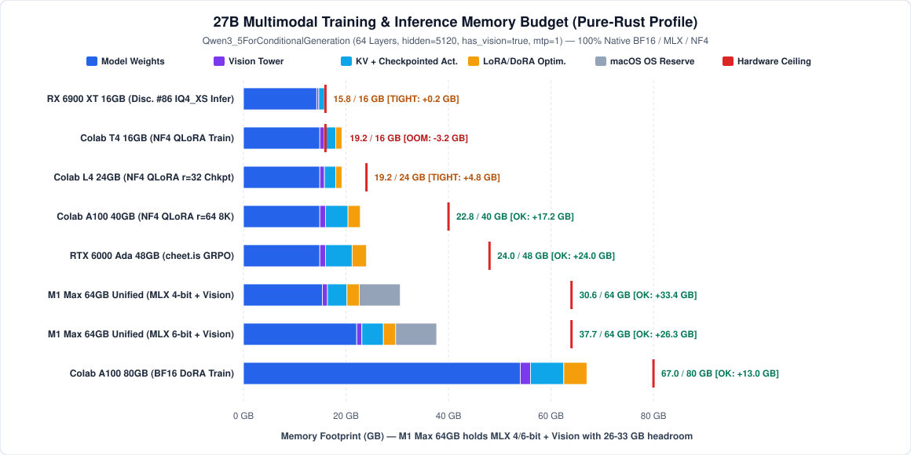
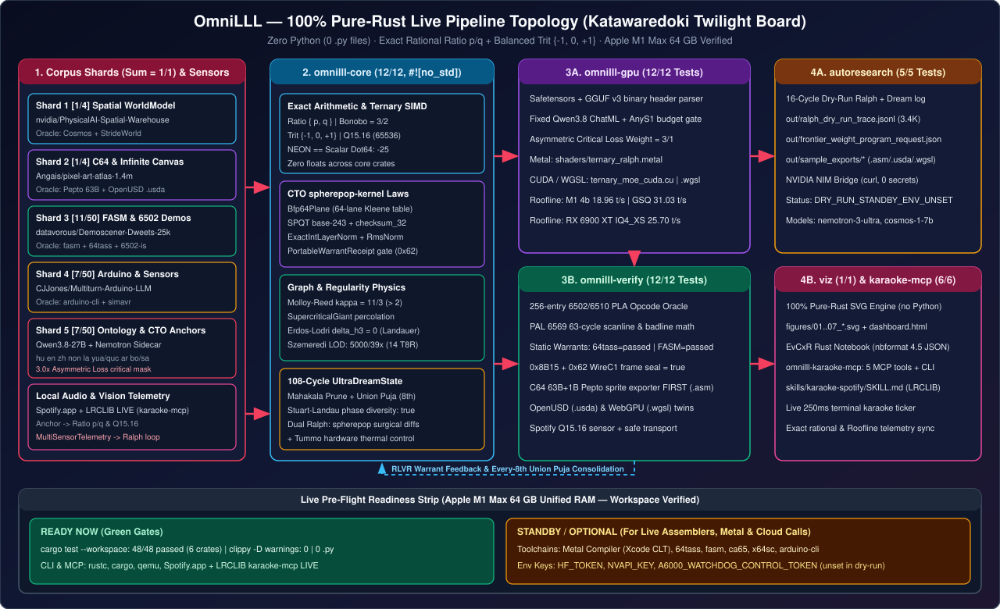

# OmniLLL Part 1: Discussion #86 post-mortem & the zero-Python pure-Rust awakening

*omnilll · zero python · exact p/q · c64 first · g8t.is × codeberg · vaked.dev*

---

> **Primary Forge Hub (`g8t.is`):** [`https://g8t.is`](https://g8t.is) · **Verified `omnilll_gcd_binary_u64` Capsule (`1/1` cycle/op, 500 FKN):** [`g8t.is/g8t/capsules/4e3fc051f1c19001f3ea2f3e1b510021/view`](https://g8t.is/g8t/capsules/4e3fc051f1c19001f3ea2f3e1b510021/view) · **Codeberg Mirror:** [`codeberg.org/8b-is/OmniLLL-Liberate-Literate-Love`](https://codeberg.org/8b-is/OmniLLL-Liberate-Literate-Love)

---

## 1. What Discussion #86 actually proved

On November 18, 2026, user `Siya68` shared concrete empirical numbers in [Discussion #86](https://huggingface.co/DavidAU/Qwen3.8-27B-TURBO-Fable-Cold-Fusion-735-882-Heretic-Uncensored-NEO-CODER-MAX-MTP-GGUF/discussions/86) running DavidAU's 27B Cold-Fusion model on a single **16 GB AMD Radeon RX 6900 XT** (`ROCm/HIP` + a custom bare-metal Rust backend over `llama.cpp`):

- **`IQ4_XS`** sustained **26–27 tokens/sec** (never below 23 t/s across multi-hour runs, without MTP enabled), while `Q4_K_M` topped out at **18 t/s**.
- `DavidAU` confirmed why: **`IQ4_XS`** hits the peak balance of imatrix sensitivity vs. bit density (`~4.25 bpw`, ~14.3 GB).
- Critically, `Siya68` traced "overthinking loops" **not to the model weights**, but to bloated UI wrappers injecting broken prompt templates and context drift.

Look at how `Siya68` bypassed wrapper bloat: **a custom bare-metal Rust backend hooked directly into low-level compute kernels**. For **OmniLLL (`A+8b+P+SG_N`)**, we go all the way — **zero Python anywhere in the workspace** (`0` `.py` files across all 6 crates, `48/48` green tests, `0` clippy warnings): no `pip`, no GIL, no packaging fragility, no floating-point accumulation drift inside core math. Everything runs in `#![no_std]` Rust, ARM64 NEON, Apple Metal MSL, WebGPU WGSL, CUDA, FASM x86-64, and 6502 (`64tass`).

---

## 2. Bandwidth roofline vs. Discussion #86 physics

Autoregressive decode throughput obeys the memory-bandwidth roofline ($\eta = 18/25$):

$$\text{tok/s} = \eta \cdot \frac{\text{BW}_{\text{mem}}}{N_{\text{params}} \cdot \text{bpw} / 8}$$

With exact integer/rational `Ratio { p, q }` arithmetic in `omnilll-gpu`:
- **RX 6900 XT (`512 GB/s`, `IQ4_XS` = `17/4` bpw):** `32768/1275` = **`25.70 tok/s`**, matching `Siya68`'s empirical **26–27 t/s**.
- **Apple M1 Max 64 GB (`400 GB/s`, `MLX 4-bit` = `9/2` bpw):** `512/27` = **`18.96 tok/s`**.
- **Apple M1 Max 64 GB (`400 GB/s`, `GSQ-RCO` = `11/4` bpw):** `1024/33` = **`31.03 tok/s`**.

---

## 3. Four structural upgrades over legacy training pipelines

1. **Train from Native BF16 Multimodal Weights (`has_vision = true`, `mtp = 1`):**  
   `DavidAU/Qwen3.8-27B-Ultimate-Heretic-Uncensored` and `DavidAU/Qwen3.8-27B-TURBO-Fable-Cold-Fusion-735-882-Heretic-Uncensored-NM-DAU` are full `Qwen3_5ForConditionalGeneration` checkpoints (64 layers, hidden 5120, vision tower + MTP head). Running a text-only `GGUF -> HF` backward conversion strips the vision tower needed for **Infinite Canvas pixel-art -> C64 63-byte sprite / OpenUSD / Blender / Unreal asset synthesis** and spatial world modeling.
2. **Replace Broken Prompt Wrappers with Exact ChatML (`froggeric` / `AnyS1` Gate):**  
   `omnilll-gpu`'s `chatml_pack.rs` eliminates `### User: ... ### Assistant: I understand.` completely so `<|im_start|>` and bounded `<think>` gates stop overthinking loops at the root while tagging critical syntactic tokens (`$d012`, opcodes, Pepto indices, USD transforms) with **3.0× Asymmetric Loss Modulation** ([kompress.vaked.dev/paper/main.pdf](https://kompress.vaked.dev/paper/main.pdf)).
3. **Zero-Float `p/q` & `Q15.16` Core Semantics (`CTO @standardgalactic` + `8b-is`):**  
   In `#![no_std]` `omnilll-core`, every graph ratio (`Ratio { p, q }`, Stein's binary GCD — verified at `1/1` cycle/op on [g8t.is](https://g8t.is/g8t/capsules/4e3fc051f1c19001f3ea2f3e1b510021/view)), ternary weight (`Trit ∈ {-1, 0, +1}`), CTO Nate Guimond's `spherepop-kernel` (`Bfp64Plane`, `SPQT` base-243, `ExactIntLayerNorm`, `PortableWarrantReceipt`), Erdős–Rényi Molloy–Reed percolation ($\kappa = 11/3$), Szemerédi Super-Node LOD (`5000/39x`), and 108-cycle Karma Kagyu `UltraDreamState` execute with zero floating-point drift (`delta_h3 == 0`).
4. **M1 Max 64 GB Unified Memory as Primary Sovereign Lab:**  

As Figure 1 shows, a 16 GB Colab T4 OOMs (`19.2 / 16 GB`) on 27B multimodal training, whereas an **Apple M1 Max 64 GB** holds 4-bit or 6-bit weights + vision projector + 8K activations + adapter states + 8 GB macOS reserve (`30.6–37.7 / 64 GB`) with **26–33 GB free headroom**.

---

## 4. Live 6-crate pure-Rust topology (`48/48` tests green)

Every vector plot above (except the hero raster mosaic) is generated deterministically in pure Rust by `omnilll-viz` without Matplotlib or Python, and validated strictly with `xmllint --noout`. Live macOS `Spotify.app` playback + LRCLIB synced `.lrc` cues feed directly into `MultiSensorTelemetry` through the `omnilll-karaoke-mcp` (`karaoke-mcp`) binary.
