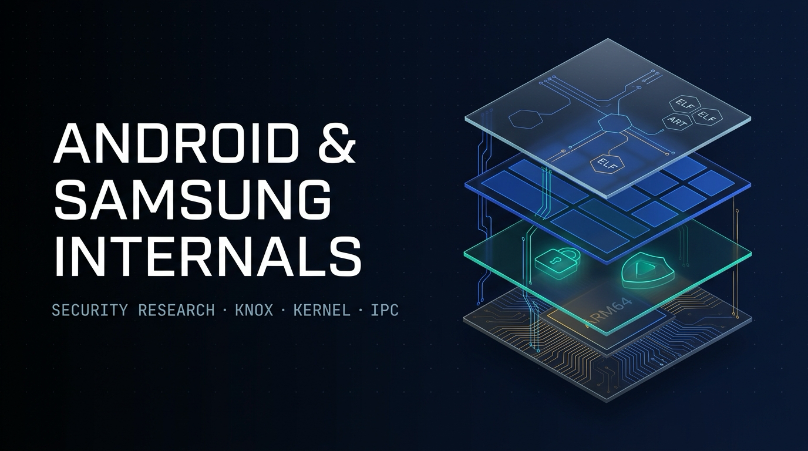

# Android 16–17 & Samsung Knox internals: 2025–2026 CVE patterns, Rust Binder, pKVM, and zero-Python binary auditing

*mobile-internals-2026 · part 1 · zero python · assembly > rust > go > ts > c · vaked.dev*

---



> **Research Repository (`68` wired projects, pure-Rust + Go CLI):** [`codeberg.org/8b-is/samsung-sec-research`](https://codeberg.org/8b-is/samsung-sec-research) · **Series Part 2 (iOS & Apple Silicon):** [iOS 18–27+ & Apple Silicon Internals](/posts/2026-11-24-ios-apple-silicon-internals-2025-2026-mie-sptm-audit.html)

---

## 1. The Android 16–17 memory-safety & isolation shift

Google's security engineering disclosures establish a structural milestone: **memory-safety vulnerabilities have dropped below 20% of total Android CVEs**, driven by Rust-first native engineering spanning userspace services down to bare-metal hypervisor firmware. Rather than treating hardening as isolated mitigations, Android 16–17 layers four enforcement boundaries:

```text
+-------------------------------------------------------------------------+
| Userspace & Device Mode                                                 |
| - Advanced Protection Mode · E2EE Intrusion Logging (12-mo off-device)  |
| - Scudo Hardened Allocator · ARM MTE · Rust Native Services             |
+-------------------------------------------------------------------------+
| Linux 6.x GKI Kernel                                                    |
| - rust_binder (drivers/android/binder/): outer / node / inner locking   |
| - init_on_alloc/free · kCFI · PAC/BTI · addr_limit / UAO removed        |
+-------------------------------------------------------------------------+
| AVF & pKVM Hypervisor (ARM64 EL2, SESIP Level 5)                        |
| - Pure-Rust pvmfw Root of Trust · Rust crosvm VMM · authfs              |
| - Protected VM (pVM) isolation resilient to host kernel compromise      |
+-------------------------------------------------------------------------+
| Hardware RoT, TEE & Post-Quantum Attestation                            |
| - KeyMint V3–V5 · COSE/RKP · ML-DSA / ML-KEM · Knox Vault / TEEGRIS     |
+-------------------------------------------------------------------------+
```

Key architectural upgrades verified across recent Google Security Blog and upstream kernel disclosures:

1. **Pure-Rust `pvmfw` & SESIP Level 5 `pKVM`:** Inside Android Virtualization Framework (AVF), `pKVM` runs at EL2 to guarantee protected VM confidentiality and integrity even if the primary Android host kernel is compromised. Rather than reusing legacy C bootloaders such as U-Boot, Protected VM Firmware (`pvmfw`) is implemented entirely in **Rust** alongside the Rust **`crosvm`** VMM and authenticated **`authfs`**.
2. **`rust_binder` Locking Architecture:** Rewriting Binder in Rust (`drivers/android/binder/` alongside legacy C in Linux 6.x) replaces error-prone manual lock patterns (`binder_spin_lock`) with a structured **outer, node, and inner** lock hierarchy designed to eradicate classic reference-count race/UAF classes.
3. **Android 16–17 Advanced Protection Mode & Intrusion Logging:** Co-designed with Amnesty International and Reporters Without Borders, Intrusion Logging records process launches, network/DNS events, USB transfers, system certificate changes, and lock/unlock state into an **end-to-end encrypted, off-device** cloud store encrypted by the user's own credentials so on-device malware cannot purge forensic trails.

---

## 2. Verified 2025–2026 CVE patterns: root causes & defenses

Reviewing 2025–2026 Android Security Bulletins (ASB), Samsung Mobile Security Releases (SMR), Google Project Zero/TAG advisories, and CISA KEV additions shows attacks shifting toward closed vendor libraries, GPU/peripheral drivers, and privileged IPC authorization gaps:

| Identifier | Component | Weakness Class | Defensive Summary & Patch Baseline |
|------------|-----------|----------------|------------------------------------|
| **CVE-2025-21043** & **CVE-2025-21042** | Samsung `libimagecodec.quram.so` | Out-of-bounds write (`CWE-787`) | Zero-click DNG raw image decoding flaw linked to LANDFALL (`b.so` / `l.so`); patched **Sept 2025 SMR** |
| **CVE-2025-21031**, **21027**, **21026** | Samsung `ImsService` | Access control (`CWE-284`) / intent check | Privileged telephony API and unauthenticated receiver handling; patched **Sept / 2025 SMR** |
| **CVE-2026-20978** | Samsung `KnoxGuardManager` | Improper authorization | Local persistence-config bypass in Knox management; patched **Early 2026 SMR** |
| **CVE-2025-48595** | Android Framework | Integer overflow (`CWE-190`) | Silent framework wraparound LPE across Android 14–16; patched **June 2026 ASB** |
| **CVE-2025-48543** | Android Runtime (`ART`) | Use-after-free | Sandbox-to-`system_server` escalation; **CISA KEV / 2025 ASB** |
| **CVE-2025-38352** | Linux Kernel (`posix-cpu-timers`) | Race condition / UAF | `handle_posix_cpu_timers()` vs `posix_cpu_timer_del()` exiting non-main thread race; **Sept 2025 ASB** |
| **CVE-2026-21385** | Qualcomm Adreno Graphics | Integer wraparound (`CWE-190`) | Alignment sizing overflow across 200+ SoCs; patched **March 2026 ASB** |
| **CVE-2025-21479** & **27038** | Qualcomm Adreno Microcode/Driver | Incorrect authorization / UAF | GPU micronode command handling & Chrome rendering UAF; patched **June 2025 ASB** |

### Cross-Platform Media Parser Parallel (`CVE-2025-21043` vs Apple `CVE-2025-43300`)

Both **CVE-2025-21043** (`libimagecodec.quram.so`) and Apple's **CVE-2025-43300** (`ImageIO` `RawCamera.bundle`, analyzed in [Part 2](/posts/2026-11-24-ios-apple-silicon-internals-2025-2026-mie-sptm-audit.html)) involved Digital Negative (**DNG**) image containers delivered zero-click through messaging media pipelines. In both ecosystems, legacy C/C++ raw parsers failed to cross-validate header tags/dimensions against internal compressed stream sizes before writing decoded pixel data — reinforcing the case for rewriting image/media codecs in memory-safe **Rust** and fuzzing remaining vendor `.so` decoders continuously with **`AFLplusplus/LibAFL`** Frida-mode.

---

## 3. Zero-Python binary & smali auditing on Galaxy S24 Ultra (`SM-S928U1`)

Enforcing our standing engineering rule — **CLIs strictly in Rust & Go (NO Python); hooks/instrumentation preference: `Assembly (AArch64) > Rust > Go > TypeScript > C`** — we eliminated all `.py` CLI wrappers in favor of **`cmd/repo-sync`** (Go managing **68** wired projects) and **`samsung-re`** (pure Rust using `m4b/goblin`, `quick-xml`, `clap`, and optional `frida-rust`):

1. **Brick-Guard Hardware Safety Gate (`samsung-re ayeos-probe`):**  
   Live ADB inspection of our test `SM-S928U1` (`e3q` / `qcom`, Android 17 SDK 37, security patch `2026-10-05`, redacted serial `<REDACTED_ANDROID_1>`) reports `ro.boot.flash.locked=1`, `verifiedbootstate=green`, and `knoxmatrix=true`. Because US Snapdragon `SM-S928U1` bootloaders are hardware-fused, `ayeOS` Brick-Guard enforces **`BLOCK_FLASHING`** and permits only non-destructive userspace (`Tier A1`) or DSU (`Tier A2b`) testing — reserving Slot-B/bare-metal flashing (`Tier A3`/`A4`) for unlockable lab devices (`Pixel 4`, `BLU G75`).
2. **Pure-Rust ARM64 ELF & Post-Quantum Crypto Triage (`samsung-re triage-elf`):**  
   Parsing 8 pulled security libraries (`keymaster@4.0/4.1`, `keymint-V3/V5-ndk`, `rkp-V3-ndk`, `secureclock-V1-ndk`, `com.samsung.security.fabric.cryptod-V1-cpp.so`, `libcppcose_rkp.so`) with `goblin` verifies `PIC=yes`, `NX=yes`, and `RELRO=full` across all targets, along with post-quantum exports (`keyAgreementPQdecap`, `keyAgreementPQencap`) and 23 COSE/CBOR primitives (`constructCoseSign1`, `aesGcmDecrypt`).
3. **Manifest + Smali IPC Authorization Audit (`samsung-re audit-ipc`):**  
   Across 58 unguarded exported components in `analysis/*/AndroidManifest.xml` (`enhanced-attestation`, `imsservice`, `knoxcore`, `kpecore`, `samsung-messaging`, `smartcallprovider`):
   - **3** enforce runtime origin/caller checks directly in `smali*/` (`SystemReceiver` via `isPackageMisMatched`, `KnoxContentProvider` via `Binder;->getCallingPid` / `getCallingUid`, and `CapsuleProvider` via `Binder;->getCallingUid`).
   - **8** are OS/manifest `protected-broadcast` receivers.
   - **5** resolve to `activity-alias` or library classes.
   - **42** (`KnoxForesightCommandReceiver`, `DualDARTestCases`, `ContainerCoreProvider`, 36 `samsung-messaging` components, etc.) are flagged for defensive hardening (`signature|privileged` manifest permissions or explicit `enforceCallingPermission` / `getSentFromUid` validation).

---

## 4. Hook hierarchy & `8b-is/ayeOS` deployment safety

For defensive tracing and observability hooks (including Binder transactions and COSE verification), `samsung-re frida-harness --lang asm|rust|go|ts` follows **`Assembly (AArch64) > Rust > Go > TypeScript > C`**: emitting AArch64 ABI-preserving `.S` entry trampolines (`stp x29, x30, [sp, #-96]!`) and `core::arch::naked_asm!` + `frida-rust` controllers by default instead of untyped JS or Python wrappers.

Continue with [**Part 2: iOS 18–27+ & Apple Silicon Internals, MIE/EMTE, SPTM/TXM, and Pure-Rust `MH_FILESET` Kernelcache Auditing**](/posts/2026-11-24-ios-apple-silicon-internals-2025-2026-mie-sptm-audit.html).
