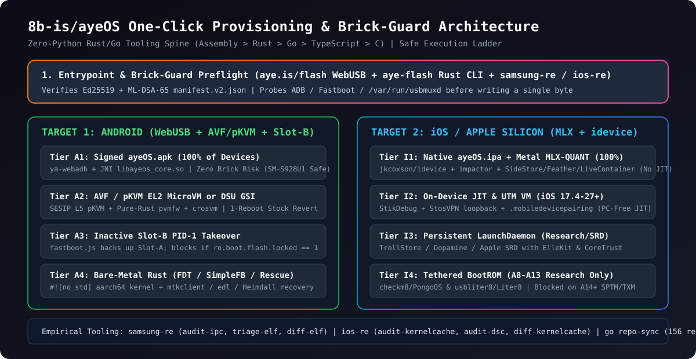

# One-click mobile OS provisioning & Brick-Guard architecture: `8b-is/ayeOS`, zero-Python Rust/Go RE tooling, and KeyMint/DSC binary diffing

*mobile-internals-2026 · part 3 · zero python · assembly > rust > go > ts > c · vaked.dev*

---



> **Series Index:** [Part 1: Android 16–17 & Samsung Knox](/posts/2026-11-24-android-samsung-internals-2025-2026-cve-rust-audit.html) · [Part 2: iOS 18–27+ & Apple Silicon MIE/SPTM](/posts/2026-11-24-ios-apple-silicon-internals-2025-2026-mie-sptm-audit.html) · **Repositories:** [`8b-is/samsung-sec-research`](https://codeberg.org/8b-is/samsung-sec-research) (68 projects) & [`8b-is/ios-internals-research`](https://codeberg.org/8b-is/ios-internals-research) (88 projects)

---

## 1. Why "one-click flash" fails without hardware Brick-Guard telemetry

Turning a single-board bare-metal OS (`8b-is/ayeOS`, originally targeting MediaTek `mt6768` Slot-B via Linux `sysfs` scripts) into a **universal one-click installer (`aye.is/flash` WebUSB + `aye-flash` Rust CLI)** fails if the installer assumes every attached USB phone accepts `fastboot flash`. Across modern Android and iOS fleets, hardware security states divide sharply:

```text
USB Device Attached (aye.is/flash OR aye-flash)
  |-- Android (ADB / Fastboot / BROM / EDL)
  |     |-- Locked / Hardware-Fused (e.g. SM-S928U1) --> BLOCK_FLASHING -> Tier A1 (APK) / A2b (DSU)
  |     |-- Android 13-17 Treble / AVF (pKVM EL2)     --> Non-Wipe Isolation -> Tier A2a (pVM) / A2b (DSU)
  |     |-- Unlocked A/B (Pixel, BLU G75, etc.)       --> Tier A3 (Slot-B PID-1 Takeover + Slot-A Guard)
  |     +-- Supported SoC + Unlocked                  --> Tier A4 (#![no_std] Bare-Metal + Rescue)
  |
  +-- iOS / Apple Silicon (/var/run/usbmuxd / RemoteXPC / DFU)
        |-- Stock iOS 16-27+ (No PC tether needed)    --> Tier I1 (Native ayeOS.ipa + Metal MLX-QUANT)
        |-- Stock iOS 17.4-27+ + .mobiledevicepairing --> Tier I2 (StikDebug + StosVPN JIT / UTM VM)
        |-- CoreTrust / Rootless / Apple SRD          --> Tier I3 (Persistent LaunchDaemon)
        +-- A8-A11 checkm8 / A12-A13 usbliter8        --> Tier I4 (Tethered Bare-Metal Only; Blocked A14+)
```

Separating a single shared `#![no_std] + alloc` spine (`ayeos-core`, signed via **Ed25519 + hybrid ML-DSA-65** `manifest.v2.json`) from target HALs (`hal-android-apk`, `hal-linux-pid1`, `hal-fdt-simplefb`, `hal-ios-metal`) lets **one WebUSB/Rust pipeline cover Android first (100% of phones safely via Tier A1–A4), then iOS (native Metal `MLX-QUANT` + `jkcoxson/idevice` + `SideStore`/`Feather`/`LiveContainer`/`StikDebug`)** without risking permanent hardware bricks.

---

## 2. Empirical KeyMint V3 → V5 & `dyld_shared_cache` audits (`samsung-re` & `ios-re`)

Both companion research repositories enforce a strict engineering standard: **CLIs strictly in Rust & Go (NO Python); hooks/reverse engineering preference: `Assembly (ARM64/arm64e) > Rust > Go > TypeScript > C`**. Extending `samsung-re` and `ios-re` with binary patch-diffing (`diff-elf`, `diff-kernelcache`) and header auditing (`audit-dsc`) yielded live empirical telemetry over our local artifacts:

### 2.1 Pure-Rust KeyMint V3 vs KeyMint V5 Export Diff (`samsung-re diff-elf`)

Diffing pulled Galaxy S24 Ultra (`SM-S928U1/XAA`, Android 17) libraries `android.hardware.security.keymint-V3-ndk.so` vs `android.hardware.security.keymint-V5-ndk.so` with `m4b/goblin`:

| Metric | Old (`keymint-V3-ndk.so`) | New (`keymint-V5-ndk.so`) |
|--------|---------------------------|---------------------------|
| Architecture | `AARCH64/64` | `AARCH64/64` |
| PIC / NX / Canary / RELRO | `true / true / false / full` | `true / true / false / full` |
| Defined Dynamic Exports | 142 | 144 |
| Symbol Delta | -0 removed | **+2 added** |

Both newly added dynamic exports expose AIDL HAL v5 additional attestation propagation on `IKeyMintDevice` (`BpKeyMintDevice::setAdditionalAttestationInfo` and `IKeyMintDeviceDefault::setAdditionalAttestationInfo`), giving binary-diffing pipelines a deterministic starting point for tracking Android 17 attestation updates.

### 2.2 Pure-Rust `dyld_shared_cache_arm64e` Header Audit (`ios-re audit-dsc`)

Parsing the first 512 bytes of extracted `21D50__iPhone14,3/dyld_shared_cache_arm64e` cleanly without external tools verifies:

| Field | Live Extracted Telemetry |
|-------|--------------------------|
| Magic | `dyld_v1  arm64e` |
| Platform | `iOS (2)` |
| Cache UUID | `036A0874-F791-35A6-BCBA-6AF946BA4D01` |
| Symbol File UUID | `B6CF57D3-81FA-3DCF-9F37-A56C40C52596` |
| Subcache Array Count | `54` |
| Embedded Images (`imagesTextCount` / `imagesCount`) | `3352` / `3352` |
| Shared Region Start / Size | `0x180000000` / `0xd2a48000` |
| `dyldInCache` Mach-O / Entry | `0x1aab11000` / `0x1aab4e460` |
| Code Signature Offset / Size | `0x74000` / `16384 B` |

Paired with `ios-re audit-kernelcache` (`UUID DDC75A3E-C9DF-8A51-EED6-C43F97763E36`, **241** `LC_FILESET_ENTRY` kexts) and `ios-re diff-kernelcache`, patch-diffing consecutive iOS IPSW builds and Android SMR `.so` libraries runs natively in single-binary Rust with zero Python runtime fragility.

---

## 3. Completing the 156-Repo Sovereign RE Workspace

Together, [`8b-is/samsung-sec-research`](https://codeberg.org/8b-is/samsung-sec-research) (**68** wired projects) and [`8b-is/ios-internals-research`](https://codeberg.org/8b-is/ios-internals-research) (**88** wired projects) provide:
- Unified Go manifest synchronization (`go run ./cmd/repo-sync -verify`).
- Pure-Rust static & live-device auditing (`audit-manifests`, `audit-ipc`, `triage-elf`, `diff-elf`, `ayeos-probe`, `triage-firmware`, `audit-kernelcache`, `audit-dsc`, `diff-kernelcache`).
- ABI-compliant observability harness generation prioritized cleanly: **`Assembly > Rust > Go > TypeScript > C`**.
