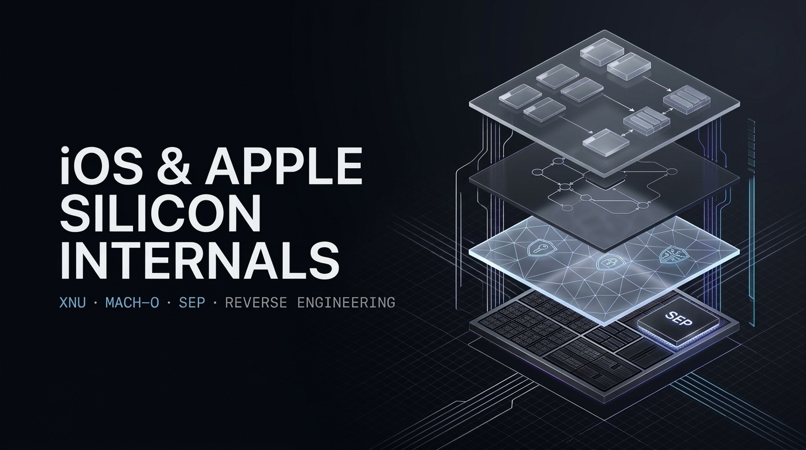

# iOS 18–27+ & Apple Silicon internals: Memory Integrity Enforcement, SPTM/TXM, 2025–2026 CVEs, and pure-Rust kernelcache auditing

*mobile-internals-2026 · part 2 · zero python · assembly > rust > go > ts > c · vaked.dev*

---



> **Research Repository (`88` wired projects, pure-Rust + Go CLI):** [`codeberg.org/8b-is/ios-internals-research`](https://codeberg.org/8b-is/ios-internals-research) · **Series Part 1 (Android & Samsung):** [Android 16–17 & Samsung Knox Internals](/posts/2026-11-24-android-samsung-internals-2025-2026-cve-rust-audit.html)

---

## 1. Apple Silicon A19 / M5+ memory integrity & compartmentalization

Recent Apple Security Research architecture publications (*"Memory Integrity Enforcement: A complete vision for memory safety in Apple devices"*, Secure Exclaves, and SPTM/TXM deep dives) trace how modern Apple Silicon has systematically compressed classic monolithic kernel exploitation:

```text
+-------------------------------------------------------------------------+
| Userspace, BlastDoor & Media/Web Parsers                                |
| - xzone malloc & libpas Type-Segregated Zones · Mandatory Sync EMTE     |
| - arm64e Pointer Authentication (PAC) · Lockdown Mode                   |
+-------------------------------------------------------------------------+
| XNU Hybrid Kernel (MH_FILESET · 241+ Kexts)                             |
| - kalloc_type Kernel Zones · Mandatory Sync EMTE                        |
| - Security/MACF/AMFI · SEP Drivers · USB/Baseband/Wireless IOKit        |
+-------------------------------------------------------------------------+
| Privilege Monitors & Secure Exclaves                                    |
| - SPTM: Physical Page Retyping, Tag Confidentiality & IOMMU/VMSA RoT    |
| - TXM: Independent Code Signing & Entitlement Policy Verification       |
| - Exclaves: Camera/Mic/Sensor Isolation via Tightbeam IDL & xnuproxy    |
+-------------------------------------------------------------------------+
| Hardware RoT                                                            |
| - BootROM · iBoot (IMG4/IM4P) · SEP (sepOS) · EMTE Hardware Tagging     |
+-------------------------------------------------------------------------+
```

Three pillars anchor **Memory Integrity Enforcement (MIE)** on A19/M5+:

1. **Type-Segregated Secure Allocators:** **`kalloc_type`** (kernel, iOS 15+), **`xzone malloc`** (userspace, iOS 17+), and **`libpas`** (WebKit) prevent objects of different types from reusing the same backing slabs, neutralizing classic type-confusion and heap shaping.
2. **Mandatory Always-On Synchronous EMTE:** Unlike asynchronous tagging modes that batch or defer fault reporting, Apple's Enhanced MTE checks pointer vs allocation tags synchronously on every access, halting immediately on corruption.
3. **Tag Confidentiality Enforcement:** To defeat speculative-execution or tag-oracle side channels, SPTM protects allocator tag stores while silicon pipelines enforce Spectre-resistant tag isolation.

---

## 2. Verified 2025–2026 Apple CVE patterns: root causes & defenses

With XNU zones walled off by SPTM, TXM, `kalloc_type`, and EMTE, 2025–2026 in-the-wild advisories cluster cleanly around parsers, early loaders (`dyld`), pure logic bugs (`XPC`, `Messages`, USB state), and proximity wireless stacks:

| Identifier | Component | Weakness Class | Defensive Summary & Patch Baseline |
|------------|-----------|----------------|------------------------------------|
| **CVE-2025-24085** | `CoreMedia` / `MediaToolbox` (`Remaker`) | Use-after-free (`CWE-416`) | Uncleared `FigRemakerTrack` pointer on `URLAssetCopyTrackByID` error path; patched **iOS 18.3** |
| **CVE-2025-24200** | USB Restricted Mode | Physical authorization bypass | Disabled USB Restricted Mode on locked devices (Citizen Lab); patched **iOS 18.3.1** |
| **CVE-2025-24201** | `WebKit` | Out-of-bounds write | Browser sandbox RCE primitive; patched **Early 2025** |
| **AirBorne** | AirPlay Protocol & SDK | Protocol & memory flaws | Network/zero-click RCE across Apple & third-party AirPlay receivers (Oligo Security); patched **iOS 18.4+** |
| **CVE-2025-31200** & **31201** | `CoreAudio` + `AppleBCMWLAN` / `RPAC` | Bounds flaw (`CWE-119`) + PAC bypass | Audio stream heap OOB paired with return-PAC bypass in zero-click iMessage chains; patched **iOS 18.4.1** |
| **CVE-2025-43200** | `Messages` / iCloud Link | Logic issue | Zero-click shared photo/video metadata trigger unaffected by memory tagging alone; **CISA KEV / 2025** |
| **CVE-2025-43300** | `ImageIO` (`RawCamera.bundle`) | Out-of-bounds write (`CWE-787`) | `CDNGLosslessJpegUnpacker` TIFF `SamplesPerPixel` vs JPEG Lossless `SOF3` mismatch (parallel to Samsung `CVE-2025-21043`); patched **iOS 18.6.2** |
| **CVE-2025-14174** & **43529** | `ANGLE` + `WebKit` | OOB access + UAF | Initial browser/GPU RCE chained with loader corruption; patched **Late 2025** |
| **CVE-2026-20700** | `dyld` (Dynamic Link Editor) | State corruption (`CWE-119`) | Early-init control-flow hijack prior to sandbox/code-sign stabilization; **Google TAG / CISA KEV (2026)** |
| **CVE-2026-86950** | `CoreGraphics` | Out-of-bounds write (`CWE-787`) | Crafted graphics/PDF parsing corruption fixed prior to **iOS 27** |
| **`usbliter8`** (`Liter8`) | Synopsys DWC2 BootROM | Silicon BootROM defect | Tethered BootROM on **A12–A13** only; A14+ / A15+ SPTM hardware is immune |

---

## 3. Empirical zero-Python firmware & `MH_FILESET` kernelcache audit (`ios-re`)

Adhering strictly to **Rust & Go ONLY for CLIs (NO Python)** and **`Assembly (arm64e) > Rust > Go > TypeScript > C`** for hooks and tooling, we built **`cmd/repo-sync`** (Go managing **88** wired projects) and **`ios-re`** (pure Rust over `m4b/goblin`, `quick-xml`, `/var/run/usbmuxd` Unix sockets, and `frida-rust` / `jkcoxson/idevice`):

1. **Native `/var/run/usbmuxd` Rust Client (`ios-re ayeos-probe`):**  
   Speaks binary/plist directly over `/var/run/usbmuxd` without Python dependencies, discovering our test target (`<REDACTED_IOS_1>`, `ProductID 0x12a8`, transports `USB, Network`) and mapping it to safe `8b-is/ayeOS` deployment tiers (`Tier I1` native `.ipa` + Metal `MLX-QUANT`; `Tier I2` on-device JIT via `StikDebug` + `.mobiledevicepairing`), while enforcing `Tier I4` BootROM blocking on A14+ SPTM/TXM devices.
2. **Firmware & DSC Verification (`ios-re triage-firmware`):**  
   Audits extracted `21D50__iPhone14,3` artifacts cleanly in Rust: `56` subcache slices (`3.80 GiB`, magic `dyld_v1  arm64e`), `53.38 MiB` `kernelcache.release.iPhone14,3`, and ASN.1 DER `IM4P` headers (`iBoot-10151.80.20` `ibot`/`ibdt`, SEP `sepi`).
3. **Mach-O `MH_FILESET` Security-Boundary Inventory (`ios-re audit-kernelcache`):**  
   Parses `kernelcache.release.iPhone14,3` (`UUID DDC75A3E-C9DF-8A51-EED6-C43F97763E36`, `arm64e`, 254 load commands) and classifies all **241** `LC_FILESET_ENTRY` kexts (`vmaddr` / `fileoff`) for deterministic patch-diffing with `blacktop/ipsw` and `Siguza/iometa`:

| Security Domain | Kext Count | Representative Bundle IDs |
|-----------------|-----------:|---------------------------|
| **Kernel Core** | 1 | `com.apple.kernel` (`0xfffffff02700c000`) |
| **Security / MACF / AMFI / Sandbox** | 5 | `AppleImage4`, `AppleMobileFileIntegrity`, `CoreTrust`, `FairPlayIOKit` |
| **SEP / Crypto / KeyStore** | 12 | `AppleSEPKeyStore`, `AppleSEPCredentialManager`, `AppleLockdownMode`, `AppleSSE`, `AppleEffaceableStorage` |
| **USB / Wireless / Baseband / AOP** | 47 | `AppleBasebandM20`, `AppleBluetoothModule`, `AppleEmbeddedUSB`, `AppleUSBDeviceMux`, `AOPTouchKext` |
| **GPU / AGX / Media / ISP** | 30 | `AGXG14P`, `AGXFirmwareKextG14PRTBuddy`, `AppleARMIISAudio` |
| **IOKit / Storage / Platform Drivers** | 146 | `ASIOKit`, `AUC`, `AppleA7IOP` |

---

## 4. `arm64e` instrumentation & defensive roadmap

For observability hooks across `XPC`, Objective-C selector tracing, and `dyld` image loading, `ios-re frida-harness --lang asm|rust|go|ts` defaults to PAC-compliant `arm64e` Assembly trampolines (`paciasp` / `autiasp`) and `core::arch::naked_asm!` + `frida-rust` / `jkcoxson/idevice` controllers (`Assembly > Rust > Go > TypeScript > C`). Pair these `vmaddr`/`fileoff` kext anchors with `blacktop/ipsw` (`ipsw kernel diff`) and `AFLplusplus/LibAFL` parser harnesses to track future SPTM, Exclave, and wireless patches cleanly.

Read [**Part 1 covering Android 16–17 (`rust_binder`, `pKVM`), Qualcomm/Samsung CVEs, and `samsung-re audit-ipc`**](/posts/2026-11-24-android-samsung-internals-2025-2026-cve-rust-audit.html).
