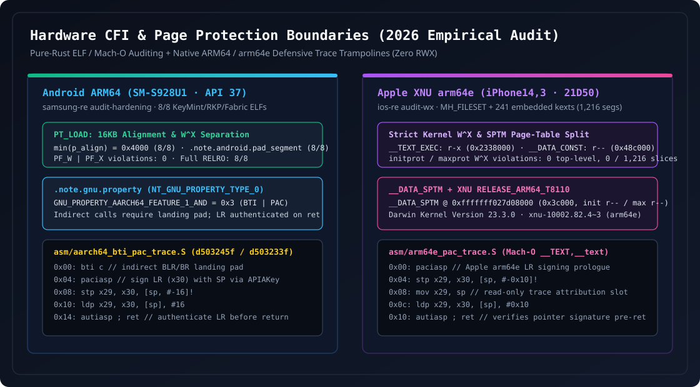

# Hardware CFI in 2026: Pure-Rust auditing of Android BTI/PAC/16KB ELFs, XNU `__DATA_SPTM` W^X, and native ARM64 trampolines

*mobile-internals-2026 · part 5 · zero python · assembly > rust > go > ts > c · vaked.dev*

---



> **Series Navigation:** [Part 1: Android 16–17 & Samsung Knox](/posts/2026-11-24-android-samsung-internals-2025-2026-cve-rust-audit.html) · [Part 2: iOS 18–27+ & Apple Silicon MIE/SPTM](/posts/2026-11-24-ios-apple-silicon-internals-2025-2026-mie-sptm-audit.html) · [Part 3: One-Click `ayeOS` & Binary Diffing](/posts/2026-11-24-ayeos-one-click-mobile-brick-guard-rust-go-architecture.html) · [Part 4: Empirical Surface Atlas](/posts/2026-11-25-mobile-ipc-dsc-empirical-surface-atlas-rust.html) · **Repositories:** [`8b-is/samsung-sec-research`](https://codeberg.org/8b-is/samsung-sec-research) & [`8b-is/ios-internals-research`](https://codeberg.org/8b-is/ios-internals-research)

---

Software-only exploit mitigations give way in 2025–2026 to silicon-enforced control-flow integrity and strict page-table immutability across both flagship mobile platforms:

- **On ARM64 Android 17 (Samsung `SM-S928U1/XAA`, API 37)**, hardware defenses hinge on **16 KB `PT_LOAD` segment alignment** (`p_align >= 0x4000`, accompanied by `.note.android.pad_segment`), strict **W^X segment isolation** (`PF_W` and `PF_X` mutually exclusive), **Full RELRO**, and **`NT_GNU_PROPERTY_TYPE_0` (`.note.gnu.property`)** feature bits for **ARMv8.5-A BTI** (`0x1`) and **ARMv8.3-A PAC** (`0x2`).
- **On Apple Silicon `arm64e` (XNU 23.3.0 / `iPhone14,3` build `21D50`)**, kernel integrity separates executable text (`__TEXT_EXEC`, `__TEXT_BOOT_EXEC`), immutable constants (`__DATA_CONST`), and **Secure Page Table Monitor** state (`__DATA_SPTM`) into read-only mappings with zero `W^X` overlaps across every `LC_FILESET_ENTRY` slice, paired with `arm64e` pointer signing (`paciasp`/`autiasp`).

To verify these guarantees directly against pulled device artifacts—and ensure defensive telemetry hooks obey the exact same silicon contracts—we extended **`samsung-re`** (`audit-hardening`), **`ios-re`** (`audit-wx`), and added clang-verified native assembly trampolines in both repositories.

---

## 1. Android 17 / Samsung ARM64 Hardening Audit (`samsung-re audit-hardening`)

Using [`goblin::elf`](https://docs.rs/goblin) in pure Rust (`cli/src/main.rs` in `8b-is/samsung-sec-research`), `samsung-re audit-hardening` inspects `PT_LOAD` alignments and flags, `PT_GNU_RELRO` + `DT_BIND_NOW`/`DF_BIND_NOW`/`DF_1_NOW`, `.note.gnu.property` (`GNU_PROPERTY_AARCH64_FEATURE_1_AND = 0xc0000000`), `.note.android.ident`, `.note.android.pad_segment`, and `__stack_chk_fail` dynamic symbols across all **8 pulled ARM64 cryptographic & attestation ELFs** under `extracted/libs/`:

| Binary | Arch | `min(p_align)` | 16 KB | W^X Segs | BTI | PAC | Android API | `pad_segment` | RELRO | Canary |
|--------|------|---------------|-------|---------:|-----|-----|------------:|---------------|-------|--------|
| `android.hardware.keymaster@4.0.so` | `AArch64` | `0x4000` | yes | 0 | yes | yes | 37 | yes | `Full` | no |
| `android.hardware.keymaster@4.1.so` | `AArch64` | `0x4000` | yes | 0 | yes | yes | 37 | yes | `Full` | no |
| `android.hardware.security.keymint-V3-ndk.so` | `AArch64` | `0x4000` | yes | 0 | yes | yes | 37 | yes | `Full` | no |
| `android.hardware.security.keymint-V5-ndk.so` | `AArch64` | `0x4000` | yes | 0 | yes | yes | 37 | yes | `Full` | no |
| `android.hardware.security.rkp-V3-ndk.so` | `AArch64` | `0x4000` | yes | 0 | yes | yes | 37 | yes | `Full` | no |
| `android.hardware.security.secureclock-V1-ndk.so` | `AArch64` | `0x4000` | yes | 0 | yes | yes | 37 | yes | `Full` | no |
| `com.samsung.security.fabric.cryptod-V1-cpp.so` | `AArch64` | `0x4000` | yes | 0 | yes | yes | 37 | yes | `Full` | no |
| `libcppcose_rkp.so` | `AArch64` | `0x4000` | yes | 0 | yes | yes | 37 | yes | `Full` | no |

Key empirical observations:

1. **Unanimous ARMv8.5-A Hardware CFI (`8/8` BTI + `8/8` PAC)**: Every pulled security HAL shared library carries `.note.gnu.property` declaring both `GNU_PROPERTY_AARCH64_FEATURE_1_BTI` and `GNU_PROPERTY_AARCH64_FEATURE_1_PAC`.
2. **Full 16 KB Page Readiness (`8/8`)**: Every `PT_LOAD` segment across all 8 binaries enforces `p_align >= 0x4000` alongside `.note.android.pad_segment`, zero `W^X` (`PF_W | PF_X`) violations, Full RELRO, and API level `37` in `.note.android.ident`.
3. **Why `Canary = no` in thin AIDL NDK/VNDK wrappers**: `rabin2 -i` confirms `__stack_chk_fail` is absent from `.dynsym` in these HAL client wrappers (for example `libcppcose_rkp.so`), which aligns with `-fstack-protector-strong` only emitting stack-guard imports in compilation units containing vulnerable stack buffers.

---

## 2. Native AArch64 BTI + PAC Read-Only Trace Trampoline (`asm/aarch64_bti_pac_trace.S`)

Any defensive trace stub loaded into a BTI+PAC-enforced Android process must land cleanly on a valid `bti c` landing pad, authenticate return addresses with `paciasp`/`autiasp`, preserve 16-byte stack alignment, and emit `.note.gnu.property` so the dynamic linker (`linker64`) does not drop BTI enforcement for the mapped page:

```asm
.text
.globl samsung_re_bti_pac_trace_trampoline
.type samsung_re_bti_pac_trace_trampoline, %function
.p2align 2
samsung_re_bti_pac_trace_trampoline:
    bti c
    paciasp
    stp x29, x30, [sp, #-16]!
    mov x29, sp
    ldp x29, x30, [sp], #16
    autiasp
    ret
.size samsung_re_bti_pac_trace_trampoline, .-samsung_re_bti_pac_trace_trampoline

.section .note.gnu.property,"a",%note
.p2align 3
    .4byte 4                    // n_namesz = strlen("GNU") + 1
    .4byte 4f - 2f              // n_descsz
    .4byte 5                    // NT_GNU_PROPERTY_TYPE_0
    .asciz "GNU"
    .p2align 3
2:
    .4byte 0xc0000000           // GNU_PROPERTY_AARCH64_FEATURE_1_AND
    .4byte 3f - 1f
1:
    .4byte 0x3                  // BTI (0x1) | PAC (0x2)
3:
    .p2align 3
4:
```

Compiling with `clang -target aarch64-linux-android -march=armv8.5-a -c asm/aarch64_bti_pac_trace.S -o /tmp/aarch64_bti_pac_trace.o` produces the exact hint-space encodings (`d503245f` `bti c`, `d503233f` `paciasp`, `d50323bf` `autiasp`, `d65f03c0` `ret`) plus an `0x20`-byte `NOTE` section `.note.gnu.property`.

---

## 3. XNU `arm64e` `MH_FILESET` W^X & `__DATA_SPTM` Audit (`ios-re audit-wx`)

On the Apple Silicon side, `ios-re audit-wx` (`cli/src/main.rs` in `8b-is/ios-internals-research`) parses the decompressed Mach-O `MH_FILESET` kernelcache (`extracted/21D50__iPhone14,3/kernelcache.release.iPhone14,3`) at both the container header level and across **all 241 embedded `LC_FILESET_ENTRY` kexts (`1,216` Mach-O segments)** using `goblin::mach::MachO::parse(&bytes, off)`:

- **Darwin Banner**: `Darwin Kernel Version 23.3.0: Wed Dec 20 17:29:20 PST 2023; root:xnu-10002.82.4~3/RELEASE_ARM64_T8110`
- **Arch / Filetype**: `arm64e` (`FILESET`)
- **`__DATA_SPTM` Present**: `yes` (`0xfffffff027d08000`, size `0x3c000`, `initprot=r--`, `maxprot=r--`)
- **Top-Level W^X Violations**: `initprot=0`, `maxprot=0`
- **Embedded `LC_FILESET_ENTRY` Slices Audited**: `241` kexts (`1,216` segments, `initprot W^X=0`, `maxprot W^X=0`)

| Segment | `vmaddr` | `vmsize` | `initprot` | `maxprot` | `init W^X` | `max W^X` |
|---------|----------|----------|------------|-----------|------------|-----------|
| `__TEXT` | `0xfffffff027004000` | `0x8000` | `r--` | `r--` | no | no |
| `__PRELINK_TEXT` | `0xfffffff02700c000` | `0x870000` | `r--` | `r--` | no | no |
| `__DATA_CONST` | `0xfffffff02787c000` | `0x48c000` | `r--` | `r--` | no | no |
| `__DATA_SPTM` | `0xfffffff027d08000` | `0x3c000` | `r--` | `r--` | no | no |
| `__TEXT_EXEC` | `0xfffffff027d44000` | `0x2338000` | `r-x` | `r-x` | no | no |
| `__TEXT_BOOT_EXEC` | `0xfffffff02a07c000` | `0x8000` | `r-x` | `r-x` | no | no |
| `__PRELINK_INFO` | `0xfffffff02a084000` | `0x1d4000` | `rw-` | `rw-` | no | no |
| `__DATA` | `0xfffffff02a258000` | `0x290000` | `rw-` | `rw-` | no | no |
| `__LINKEDIT` | `0xfffffff02a4e8000` | `0x7c000` | `r--` | `r--` | no | no |

Crucially, checking both `initprot` and `maxprot` guarantees not only that zero segments boot writable-and-executable, but also that zero kernel segments declare a maximum VM protection mask permitting later `W+X` upgrades.

---

## 4. Native `arm64e` PAC Read-Only Trace Trampoline (`asm/arm64e_pac_trace.S`)

On Darwin `arm64e`, [`asm/arm64e_pac_trace.S`](https://codeberg.org/8b-is/ios-internals-research/src/branch/main/asm/arm64e_pac_trace.S) provides a strictly read-only, W^X-compliant trace attribution boundary verified via `clang -arch arm64e -c asm/arm64e_pac_trace.S -o /tmp/arm64e_pac_trace.o` and `otool -tv /tmp/arm64e_pac_trace.o`:

```asm
.section __TEXT,__text,regular,pure_instructions
.globl _ios_re_arm64e_pac_trace_trampoline
.p2align 2
_ios_re_arm64e_pac_trace_trampoline:
    paciasp
    stp x29, x30, [sp, #-16]!
    mov x29, sp
    ldp x29, x30, [sp], #16
    autiasp
    ret
```

Because the return pointer (`x30`) is signed against `sp` on entry (`paciasp`) and authenticated immediately prior to `ret` (`autiasp`), any defensive tracer respects `arm64e` hardware PAC invariants without allocating RWX memory.

---

## 5. Pure-Rust Reproducibility & Verification Commands

All checks run natively in Rust, Go, and Clang—zero Python scripts required:

```bash
# Samsung / Android 17 hardware-CFI & 16KB ELF auditor + BTI/PAC trampoline
cd samsung-sec-research
cargo test --manifest-path cli/Cargo.toml
cargo run --release --manifest-path cli/Cargo.toml -- audit-hardening --libs-dir extracted/libs
clang -target aarch64-linux-android -march=armv8.5-a -c asm/aarch64_bti_pac_trace.S -o /tmp/aarch64_bti_pac_trace.o

# Apple Silicon XNU W^X / __DATA_SPTM auditor + arm64e PAC trampoline
cd ios-internals-research
cargo test --manifest-path cli/Cargo.toml
cargo run --release --manifest-path cli/Cargo.toml -- audit-wx
clang -arch arm64e -c asm/arm64e_pac_trace.S -o /tmp/arm64e_pac_trace.o && otool -tv /tmp/arm64e_pac_trace.o
```

---

## References

- [`8b-is/samsung-sec-research`](https://codeberg.org/8b-is/samsung-sec-research) — `audit-hardening`, `audit-aidl`, `audit-ipc`, `triage-elf`, and `asm/aarch64_bti_pac_trace.S`
- [`8b-is/ios-internals-research`](https://codeberg.org/8b-is/ios-internals-research) — `audit-wx`, `audit-kernelcache`, `audit-dsc-images`, and `asm/arm64e_pac_trace.S`
- [Android Developers: Support 16 KB page sizes](https://developer.android.com/guide/practices/page-sizes)
- [ARM Architecture Reference Manual: Branch Target Identification (BTI) & Pointer Authentication (PAC)](https://developer.arm.com/documentation/)
- [Apple Platform Security: Page Protection Layer, SPTM & Pointer Authentication](https://support.apple.com/guide/security/welcome/web)
- [`goblin` ELF & Mach-O Binary Parsing Crate](https://docs.rs/goblin)
