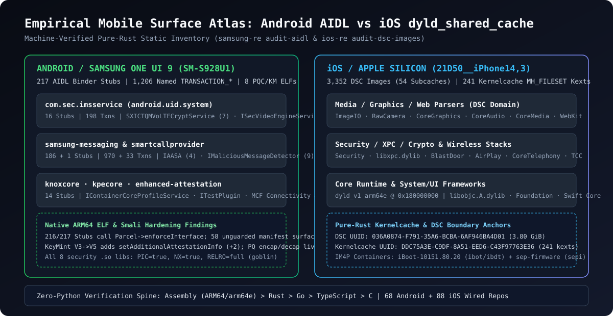

# Empirical mobile surface atlas: pure-Rust auditing of Samsung AIDL Binder Stubs and 3,352 iOS `dyld_shared_cache` images

*mobile-internals-2026 · part 4 · zero python · assembly > rust > go > ts > c · vaked.dev*

---

> **Series Navigation:** [Part 1: Android 16–17 & Samsung Knox](/posts/2026-11-24-android-samsung-internals-2025-2026-cve-rust-audit.html) · [Part 2: iOS 18–27+ & Apple Silicon MIE/SPTM](/posts/2026-11-24-ios-apple-silicon-internals-2025-2026-mie-sptm-audit.html) · [Part 3: One-Click `ayeOS` & Binary Diffing](/posts/2026-11-24-ayeos-one-click-mobile-brick-guard-rust-go-architecture.html) · **Repositories:** [`8b-is/samsung-sec-research`](https://codeberg.org/8b-is/samsung-sec-research) & [`8b-is/ios-internals-research`](https://codeberg.org/8b-is/ios-internals-research)

---

Modern mobile defense hinges on knowing **every IPC transaction switch table** on Android and **every userspace framework base mapping** inside Apple's shared cache — without relying on fragile Python toolchains. Expanding **`samsung-re`** (`audit-aidl`) and **`ios-re`** (`audit-dsc-images`) yields a complete machine-verified atlas across both platforms in pure Rust.

---

## 1. Android / Samsung AIDL Binder Stub Atlas (`samsung-re audit-aidl`)

Walking `analysis/*/smali*` across the 6 pulled Samsung Galaxy S24 Ultra (`SM-S928U1/XAA`, Android 17) APKs for `onTransact(ILandroid/os/Parcel;Landroid/os/Parcel;I)Z` extracts **217 AIDL Binder Stubs** and **1,206** named `TRANSACTION_*` codes:

| App Dir | AIDL Stubs (`onTransact`) | Named `TRANSACTION_*` | `enforceInterface` | Inline Stub Caller-Guard |
|---------|--------------------------:|----------------------:|-------------------:|-----------------------:|
| `enhanced-attestation` | 1 | 0 | 1 | 0 |
| `imsservice` | 16 | 198 | 16 | 0 |
| `knoxcore` | 6 | 0 | 6 | 0 |
| `kpecore` | 7 | 5 | 7 | 0 |
| `samsung-messaging` | 186 | 970 | 185 | 0 |
| `smartcallprovider` | 1 | 33 | 1 | 0 |

Notable Samsung, carrier, and Knox AIDL interfaces inventoried (`153` vendor-prefixed Stubs total):

| Stub Class | Txns | `enforceInterface` | Descriptor |
|------------|-----:|:------------------:|------------|
| `com.sec.sve.ISecVideoEngineService$Stub` | 114 | yes | `com.sec.sve.ISecVideoEngineService` |
| `com.att.iqi.IIQIBroker$Stub` | 14 | yes | `com.att.iqi.IIQIBroker` |
| `com.samsung.android.imsdcservice.IImsDataChannelServiceController$Stub` | 14 | yes | `com.samsung.android.imsdcservice.IImsDataChannelServiceController` |
| `com.att.iqi.IIQIService$Stub` | 13 | yes | `com.att.iqi.IIQIService` |
| `com.samsung.aasaservice.IMaliciousMessageDetector$Stub` | 9 | yes | `com.samsung.aasaservice.IMaliciousMessageDetector` |
| `com.voltecrypt.service.SXICTQMVoLTECryptService$Stub` | 7 | yes | `com.voltecrypt.service.SXICTQMVoLTECryptService` |
| `com.samsung.aasaservice.IAASA$Stub` | 4 | yes | `com.samsung.aasaservice.IAASA` |
| `com.samsung.android.deviceidservice.IDeviceIdService$Stub` | 3 | yes | `com.samsung.android.deviceidservice.IDeviceIdService` |

Notice the defensive architecture signal: **216/217** Stubs call `Parcel->enforceInterface`, yet inline caller-UID checks live in service implementations rather than Stubs — making unified `audit-ipc` + `audit-aidl` auditing essential to ensure every exposed `Stub` backs onto explicit `signature|privileged` manifest permissions or server-side UID validation.

---

## 2. iOS `dyld_shared_cache` 3,352-Image Atlas (`ios-re audit-dsc-images`)

Directly parsing `imagesOffset` (`0x270`) and `imagesCount` (`3352`) from `21D50__iPhone14,3/dyld_shared_cache_arm64e` (`dyld_v1  arm64e`, Cache UUID `036A0874-F791-35A6-BCBA-6AF946BA4D01`) classifies all **3,352** embedded images into architectural domains:

| Architectural Domain | Embedded Image Count |
|----------------------|---------------------:|
| **Media / Graphics / Web Parsers** | 33 |
| **Security / Crypto / Auth / XPC** | 29 |
| **Wireless / Telephony / Proximity** | 96 |
| **Core Runtime / `dyld` / Swift / ObjC** | 104 |
| **System & UI Frameworks** | 3,090 |

For defensive binary triage and AArch64/`arm64e` instrumentation anchoring (`Assembly > Rust > Go > TypeScript > C`), the exact unslid `arm64e` load addresses of key 2025–2026 CVE-tracked subsystems in `21D50__iPhone14,3` resolve immediately:

| Shared-Cache Image Path | Unslid `arm64e` Base Address | Domain |
|-------------------------|-----------------------------:|--------|
| `/usr/lib/libobjc.A.dylib` | `0x1800e8000` | Core Runtime / `dyld` / Swift / ObjC |
| `/System/Library/Frameworks/CoreTelephony.framework/CoreTelephony` | `0x189235000` | Wireless / Telephony / Proximity |
| `/System/Library/Frameworks/CoreGraphics.framework/CoreGraphics` | `0x189907000` | Media / Graphics / Web Parsers |
| `/System/Library/Frameworks/ImageIO.framework/ImageIO` | `0x18da70000` | Media / Graphics / Web Parsers |
| `/System/Library/Frameworks/Security.framework/Security` | `0x19062f000` | Security / Crypto / Auth / XPC |
| `/System/Library/Frameworks/CoreMedia.framework/CoreMedia` | `0x1944b6000` | Media / Graphics / Web Parsers |
| `/System/Library/Frameworks/MediaToolbox.framework/MediaToolbox` | `0x198996000` | Media / Graphics / Web Parsers |
| `/System/Library/Frameworks/WebKit.framework/WebKit` | `0x19cacd000` | Media / Graphics / Web Parsers |
| `/System/Library/Frameworks/JavaScriptCore.framework/JavaScriptCore` | `0x19d824000` | Media / Graphics / Web Parsers |
| `/System/Library/PrivateFrameworks/BlastDoor.framework/BlastDoor` | `0x1b168c000` | Security / Crypto / Auth / XPC |
| `/System/Library/Frameworks/CoreAudio.framework/CoreAudio` | `0x1b8c4f000` | Media / Graphics / Web Parsers |
| `/System/Library/PrivateFrameworks/AirPlaySender.framework/AirPlaySender` | `0x1cbe94000` | Wireless / Telephony / Proximity |
| `/System/Library/CoreServices/RawCamera.bundle/RawCamera` | `0x1e7c68000` | Media / Graphics / Web Parsers |
| `/usr/lib/system/libxpc.dylib` | `0x1f1ef5000` | Security / Crypto / Auth / XPC |

Combined with `audit-kernelcache` (**241** `LC_FILESET_ENTRY` kexts in `kernelcache.release.iPhone14,3`) and `audit-ipc` / `diff-elf` on Android, both security research workspaces run 100% natively in **Rust & Go** with reproducible JSON/Markdown artifacts.
