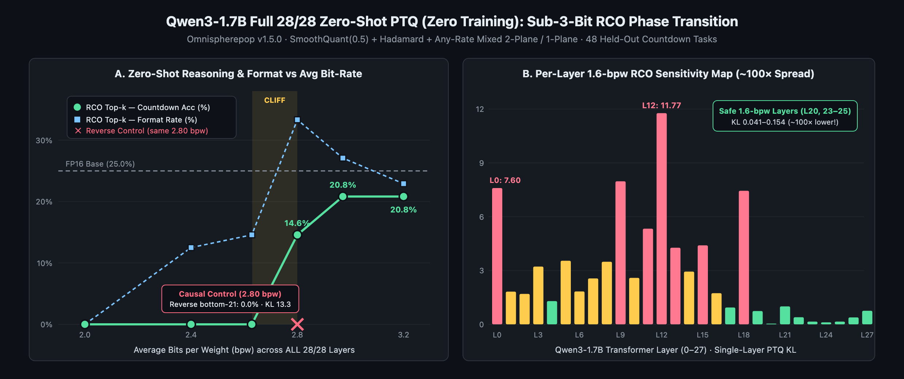
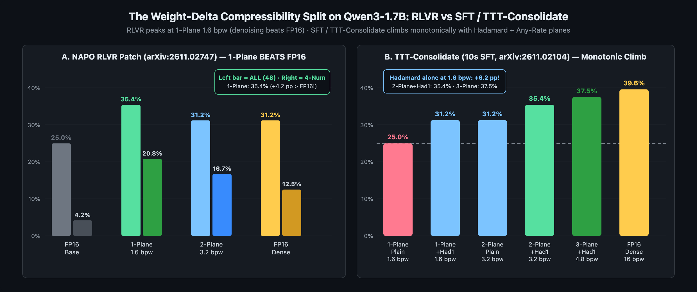

# OmniLLL Part 3: Sub-3-Bit Zero-Shot Reasoning, The RLVR-vs-TTT Law, and LoopKit

*omnilll · quantization & rlvr · fine touch from within · vaked.dev*

---

Every quantization experiment eventually hits the same cliff: quantize all 28 layers of a small reasoning model below 4 bits with zero recovery training, and accuracy drops straight to `0.0%`.

Using [**Omnispherepop `v1.5.0`**](https://github.com/8b-is/omnispherepop) (`ospop`, zero-unsafe Rust on crates.io) on a **free Google Colab Tesla T4 (0.00 CU)**, we ran two systematic experiments on **`Qwen/Qwen3-1.7B`** (all 28 layers / 196 linear projections, evaluated greedily on 48 deterministic held-out Countdown arithmetic tasks verified with an exact `fractions.Fraction` AST evaluator).

Two clean empirical laws fell out:

1. **Sub-3-bit zero-shot reasoning (`2.97 bpw`, zero training):** Fusing per-channel `SmoothQuant(α=0.5)` + orthonormal Walsh-Hadamard pre-rotation + sensitivity-ranked **Any-Rate progressive 2-plane/1-plane ternary** (`arXiv:2611.34402` + `arXiv:2605.00649`) breaks right through the `Qwen3-1.7B` `28/28` zero-shot cliff at **`2.80 bpw`** (`14.6%`) and reaches full `3.20 bpw` parity at **`2.97 bpw`** (`20.8%` overall, `8.3%` on 4-number tasks = 2× FP16 base). A reverse-ordered **causal control at the exact same `2.80 bpw`** collapses to `0.0%` (`KL = 13.32` vs `6.28`).
2. **RLVR vs SFT/TTT-Consolidate weight-delta compressibility split:** Compressing **RLVR/NAPO** (`arXiv:2611.02747`) deltas to **1-plane `1.6 bpw`** *beats* dense FP16 (`35.4%` vs `31.2%`) by denoising policy-gradient noise. Compressing fast 10-second **TTT-Consolidate** (`arXiv:2611.02104`) SFT deltas behaves in the exact opposite way: 1-plane plain erases the gain (`25.0%`), Walsh-Hadamard rotation alone recovers **`+6.2 pp`** at `1.6 bpw` (`31.2%`), and **Any-Rate 2-plane/3-plane + Hadamard** climbs monotonically to **`35.4%` (`3.2 bpw`)** and **`37.5%` (`4.8 bpw`, exact FP16 3-num parity)**.

#### 1. Breaking the Full `28/28` Zero-Shot Cliff on `Qwen3-1.7B` (Zero Training)

Measuring single-layer `1.6-bpw` PTQ KL across all 28 layers of `Qwen3-1.7B` revealed a **~100× sensitivity spread**: early/mid hubs (`L12: 11.77`, `L9: 7.97`, `L0: 7.60`, `L18: 7.44`) dominate quantization error, while late layers (`L20: 0.041`, `L24: 0.109`, `L23–L25: 0.151–0.154`) barely budge at 1.6 bits.

Allocating **Any-Rate 2-Plane (`3.2 bpw`)** to the top-`k` sensitive layers and **1-Plane (`1.6 bpw`)** to the remaining `28 − k` layers (with `SmoothQuant(0.5) + Had1`, zero fine-tuning):

| Allocation (`Qwen/Qwen3-1.7B`, ALL 28/28 layers, 0-shot) | 2-Plane Layers | Avg bpw | `KL_28` | Countdown Acc | 3-Num | 4-Num | Format |
|---|---:|---:|---:|---:|---:|---:|---:|
| `FP16 Base` | — | 16.00 | 0.000 | 25.0% | 45.8% | 4.2% | 27.1% |
| `Any-Rate 2-Plane + Had1` *(no SmoothQuant)* | 28 / 28 | 3.20 | 13.650 | 0.0% | 0.0% | 0.0% | 0.0% |
| `rco_top_14` | 14 / 28 | 2.40 | 9.585 | 0.0% | 0.0% | 0.0% | 12.5% |
| `rco_top_18` | 18 / 28 | 2.63 | 8.173 | 0.0% | 0.0% | 0.0% | 14.6% |
| **`rco_top_21` (phase transition)** | **21 / 28** | **2.80** | **6.283** | **14.6%** | **25.0%** | **4.2%** | **33.3%** |
| *`control_reverse_bottom_21` (CAUSAL CONTROL)* | *21 / 28 (reverse)* | *2.80* | *13.321* | *0.0%* | *0.0%* | *0.0%* | *0.0%* |
| **`rco_top_24` (sub-3-bit parity)** | **24 / 28** | **2.97** | 11.494 | **20.8%** | **33.3%** | **8.3%** | **27.1%** |
| `all_28_two_plane` | 28 / 28 | 3.20 | 8.512 | 20.8% | 37.5% | 4.2% | 22.9% |

Notice two things:
1. Without SmoothQuant activation scaling, even full `3.20 bpw` 2-plane + Hadamard collapses (`KL = 13.65`, `0.0%`). Adding `SmoothQuant(0.5)` cuts `KL` to `8.51` and unlocks **`20.8%` (83.2% of FP16 base)** zero-shot.
2. At identical **`2.80 bpw`**, putting the 2-plane budget on the top-21 RCO-sensitive layers jumps from `0.0% → 14.6%` (`KL = 6.28`), while putting the exact same bit budget on the bottom-21 layers collapses (`0.0%`, `KL = 13.32`, 11.5 tokens).



#### 2. The RLVR vs SFT/TTT-Consolidate Weight-Delta Compressibility Split

We ran **TTT-Consolidate** (`arXiv:2611.02104`) on `Qwen3-1.7B` with zero external labels: sample `K=6` rollouts per problem, keep only exact AST-verified traces (`23/48`, `pass@6 = 47.9%`), and consolidate via 24 LoRA SFT steps (**10.4 seconds on T4**). Greedy accuracy jumped **`25.0% → 39.6%`** (`+14.6 pp`, `4-num: 4.2% → 16.7%`).

Then we compressed that exact same weight delta `ΔW_ttt = W_ttt − W_base` across 5 progressive ternary encodings and compared it to our **NAPO RLVR** (`arXiv:2611.02747`) patch on the same model:

| Encoding for `ΔW_ttt` (`Qwen/Qwen3-1.7B`) | bpw | Energy Retained | Countdown Acc | 3-Num | 4-Num | Format |
|---|---:|---:|---:|---:|---:|---:|
| `FP16 Base` (no patch) | — | — | 25.0% | 45.8% | 4.2% | 27.1% |
| `1-Plane Plain` | 1.6 | 82.1% | 25.0% | 45.8% | 4.2% | 25.0% |
| **`1-Plane + Had1` (Hadamard alone: +6.2 pp!)** | **1.6** | 81.1% | **31.2%** | **58.3%** | 4.2% | 31.2% |
| `Any-Rate 2-Plane Plain` | 3.2 | 96.2% | 31.2% | 50.0% | **12.5%** | 31.2% |
| **`Any-Rate 2-Plane + Had1` (−80% vs FP16)** | **3.2** | 95.7% | **35.4%** | **58.3%** | **12.5%** | **37.5%** |
| **`Any-Rate 3-Plane + Had1` (−70% vs FP16)** | **4.8** | **98.2%** | **37.5%** | **62.5%** | **12.5%** | **39.6%** |
| `FP16 TTT-Consolidate Dense` | 16.0 | 100.0% | 39.6% | 62.5% | 16.7% | 41.7% |

**Why the split?**
- **RLVR (Dr. GRPO / NAPO / MARL)** updates are noisy, high-variance policy gradients spread over many steps: 1-plane `0.7 · mean|Δw|` thresholding strips the noisy tail and **beats dense FP16** (`35.4%` vs `31.2%`, `20.8%` vs `12.5%` on hard 4-num).
- **Short-horizon SFT / TTT-Consolidate** (`10.4s`) writes fine-grained memorized trajectory shifts (`0.153%` trit flip, `0` sign flips) whose small-magnitude tail carries the signal — so **Walsh-Hadamard pre-rotation** (dispersing small coordinates before thresholding, `+6.2 pp` at `1.6 bpw`) + **Any-Rate nested residual planes** (`3.2–4.8 bpw`) recover it cleanly.



#### 3. Shipped in Zero-Unsafe Rust: Omnispherepop `v1.5.0` + `loopkit` + `llm-belie-fs`

Everything above is implemented in zero-unsafe Rust (`#![forbid(unsafe_code)]`) and published on crates.io:

```bash
cargo install ospop-cli ospop-mcp

# Progressive 3-plane Any-Rate + Hadamard in ONE .ospop.safetensors file (10.77x MSE drop)
ospop --file ckpt.safetensors any-rate --tensor layer14.o_proj.ttt --planes 3 --hadamard

# Stack 4 independent skill patches [Math RLVR + InfoGain MARL + Ablagent DWM + TTT] order-independently (JNSP)
ospop --file ckpt.safetensors apply-delta --tensor layer14.o_proj.base \
  --patch math.ospop.safetensors --patch marl.ospop.safetensors \
  --patch dwm.ospop.safetensors --patch ttt.ospop.safetensors --jnsp

# Autonomous Karpathy Ratchet Loop + llm-wiki [[wiki-links]] experiment graph + Grimoire ledger
ospop --file ckpt.safetensors loop --goal quantize --tensor layer14.o_proj.base --budget 7 --wiki
ospop --file ckpt.safetensors loop --goal dwm --tensor layer14.o_proj.base --rows 256 --budget 6 --wiki
```

- **Code & Benchmarks:** https://github.com/8b-is/omnispherepop (`v1.5.0`, 14-tool MCP server)
- **Public Dataset, JSON Logs & Patches:** https://huggingface.co/datasets/eightb/omnispherepop-benchmarks
- **Training-free Modification Companion (`ospop-core 1.5.0` powered):** https://github.com/peterlodri-sec/llm-belie-fs

#### 4. `LoopKit` & `llm-belie-fs`

Across Runs 1–7, we kept running the same research loop by hand: propose a quantization or ablation knob, measure deterministic evidence, freeze winners, record dead-ends so we never waste a GPU run repeating them.

In **`ospop v1.5.0`**, we baked that pattern directly into the Rust core as **`loopkit`** — unifying three ideas:
- **Karpathy's `autoresearch` Ratchet Loop:** strict `KEEP` / `REVERT` frontier + hard budget + same-result-twice plateau exit.
- **Karpathy's `llm-wiki` Knowledge Graph:** every run emits a `[[wiki-link]]`-connected Markdown DAG (`## Frozen Passed Nodes`, `## Dead Ends (Do Not Retry)`, `## Graph Edges`) ready for an Obsidian vault or agent workspace.
- **[`llm-belie-fs`](https://github.com/peterlodri-sec/llm-belie-fs) Grimoire receipts:** append-only hash-chained provenance, now wired straight into `llm-believes v0.2.0` (`ospop-core = "1.5.0"`).

On real `Qwen3-1.7B` `layer14.o_proj.base`, `ospop loop --goal dwm` autonomously walks `α = 0.25 → 0.45 → 0.60 → 0.75` (`54.2%` verified 1.58-bit attenuation) and **automatically blocks `α = 0.90` & `1.00`** the moment the `arXiv:2611.00665` deployed-precision drift gate trips — zero human babysitting, zero vibe checks.
